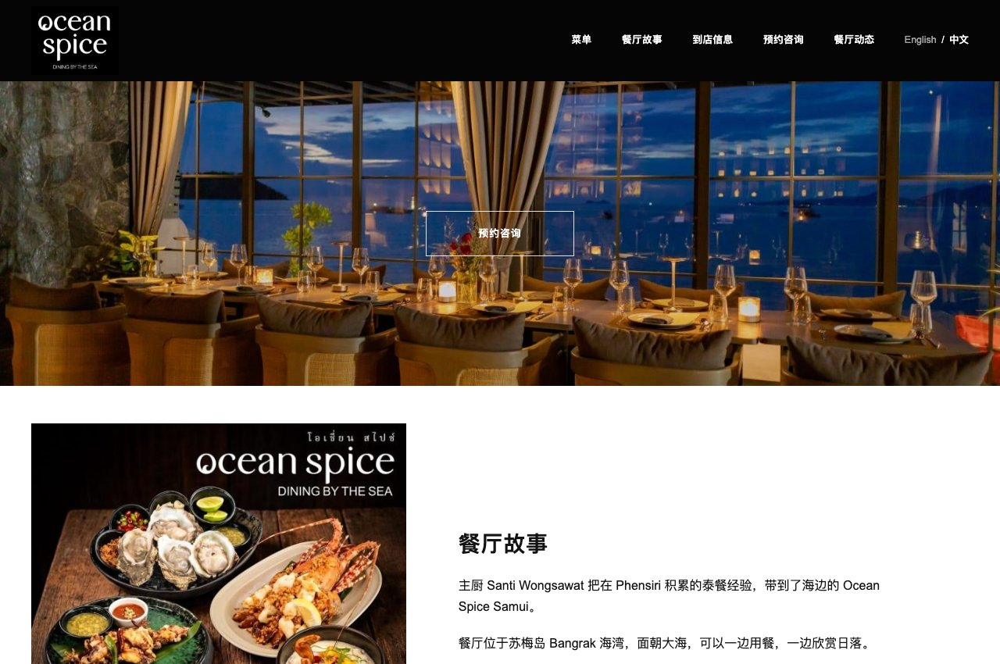
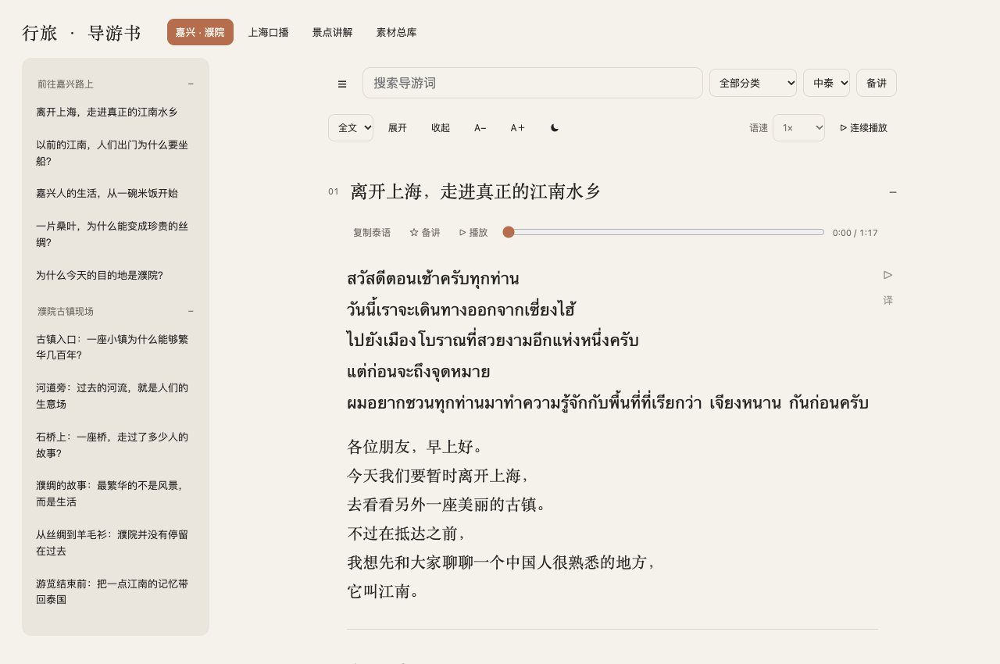

# 刘承龙 · 作品集

**[打开作品展示页 →](https://kinniuroudong-glitch.github.io/portfolio/)**

GitHub：[kinniuroudong-glitch](https://github.com/kinniuroudong-glitch)

## Ocean Spice｜海外餐厅菜单与预约网站

**需求：** 让中文客人能读懂英泰菜单，查看菜品与价格，并体验预约流程。

**本人贡献：** 对照 38 页英泰原菜单，整理 85 道菜，保留英文原名与泰铢价格；核对原料歧义，确定中文译名。使用 Codex、Claude Code 辅助需求分解、页面调试与部署，制作中英双语菜单、顾客预约页面及店员英文图解。

| 原菜单位置 | 英文原文 | 泰文原文 | 中文定名 |
| --- | --- | --- | --- |
| 第 34 页 | Prawn Roe | มันกุ้ง | 虾膏 |

**可查看交付：** [餐厅体验网站](https://ocean-spice-owner-review.kinniuroudong.chatgpt.site/)，包含菜单、预约体验及店员英文图解。当前为供店方体验的版本，待正式验收；体验预约不会实际订位或发送邮件。

## 行旅｜中泰双语导游助手

**需求：** 带团备稿与现场讲解时，快速找到中泰对照内容，并练习泰语讲解。

**本人贡献：** 整理导游素材与阅读流程，确定双语呈现、长短讲解及音频跟读需求；使用 Codex、Claude Code 辅助需求分解、页面调试与部署，持续核对页面与实际使用流程。

**可查看交付：** [中泰双语导游书](https://jiaxing-puyuan-thai-guide.pages.dev/)，共 351 条内容，其中 129 条为上海口播素材；支持搜索、收藏及长短讲解切换。嘉兴与濮院的 11 章配有泰语合成音频，可逐段跟读；上海及其他分类目前为文字内容。

[GitHub 备用：内容与源码](https://github.com/kinniuroudong-glitch/travel-guide-zh-th)

## 泰语词汇卡

**需求：** 将分散的泰语词目变成便于点读、查看例句与继续学习的卡片。

**本人贡献：** 使用 AI 辅助整理词目，确定词卡阅读、点读、逐词释义与续读流程；使用 Codex、Claude Code 辅助需求分解、页面调试与部署。词目与释义不作为逐条人工审校的辞典成果。

**可查看交付：** [泰语词汇卡](https://kinniuroudong-glitch.github.io/thai-vocabulary-studio/)，含 13,680 条词目，可查看例句、点读并逐词查看释义。

[GitHub 备用：内容与源码](https://github.com/kinniuroudong-glitch/thai-vocabulary-studio)
